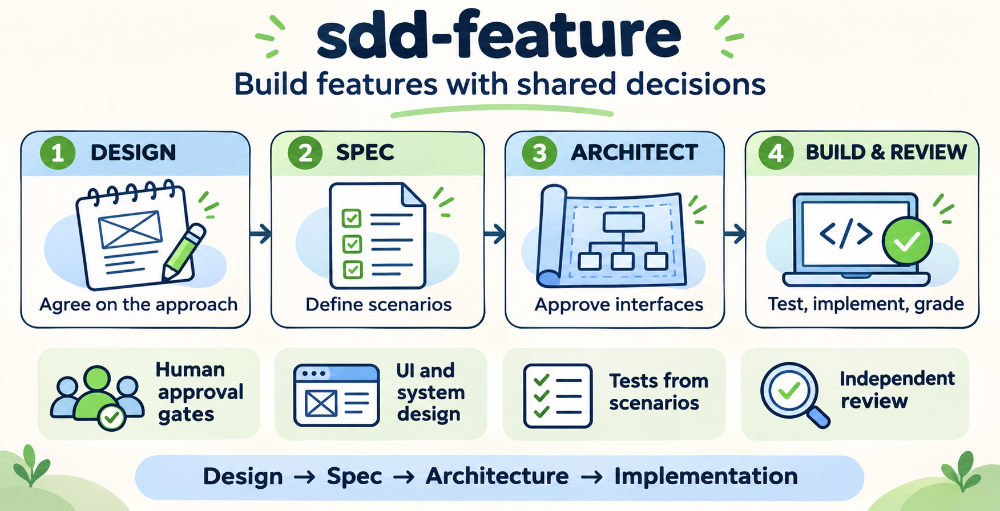
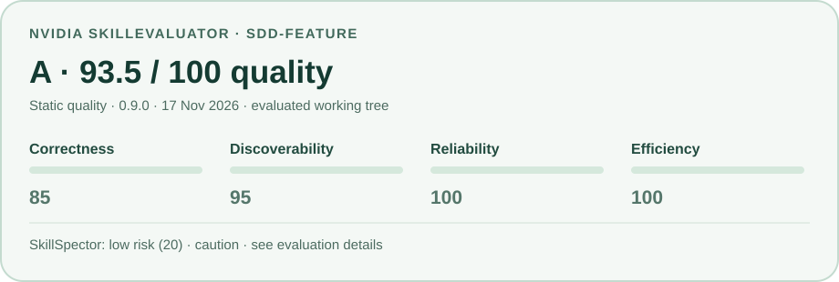

<p align="center"></p>

# sdd-feature

[](https://github.com/illescasDaniel/sdd-feature-skill/actions/workflows/ci.yml) · [MIT](LICENSE)

A structured feature workflow with human approval gates, tests and an independent grade.

## How it works



| Step | What happens |
| --- | --- |
| Design | Approve the wireframe or system design |
| Spec | Agree scenarios and constraints |
| Architecture | Approve interfaces |
| Build & grade | Test, implement and independently review |

## Quick start

```bash
npx skills add illescasDaniel/sdd-feature-skill
```

For manual installation, details and limitations, see the [guide](docs/guide.md).

## Requirements and limits

Python 3 for checks; Node and network access for optional Mermaid validation. Agent instructions are conventions, not sandbox boundaries. Preview only trusted design files: rendered Markdown can contain active HTML and is not sanitized.

## Evaluation

[](docs/evaluation.md)

SkillEvaluator 0.9.0 gave **A, 93.5/100** on the evaluated working tree. Tier 1 still fails on three intentional placeholder links in templates; they point to project-specific files once filled in. Static heuristics do not measure agent performance. [Evaluation details](docs/evaluation.md).

## Tests

Run the standard-library offline script tests with `python3 -m unittest discover -s tests -v`. They cover structural checks and preview generation; they do not evaluate agent behavior.

## License

[MIT](LICENSE).
